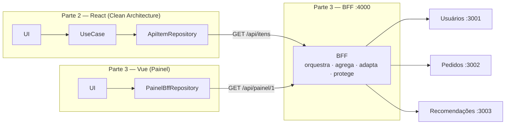
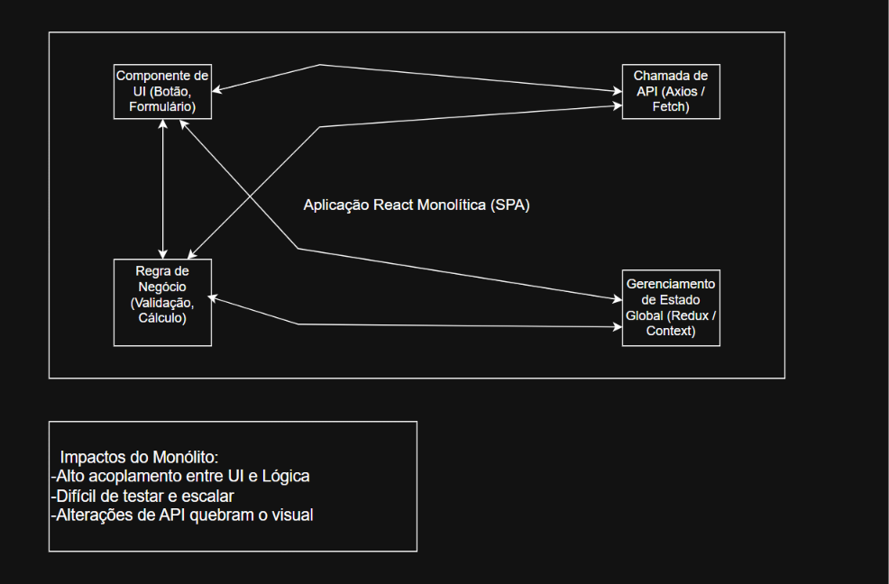
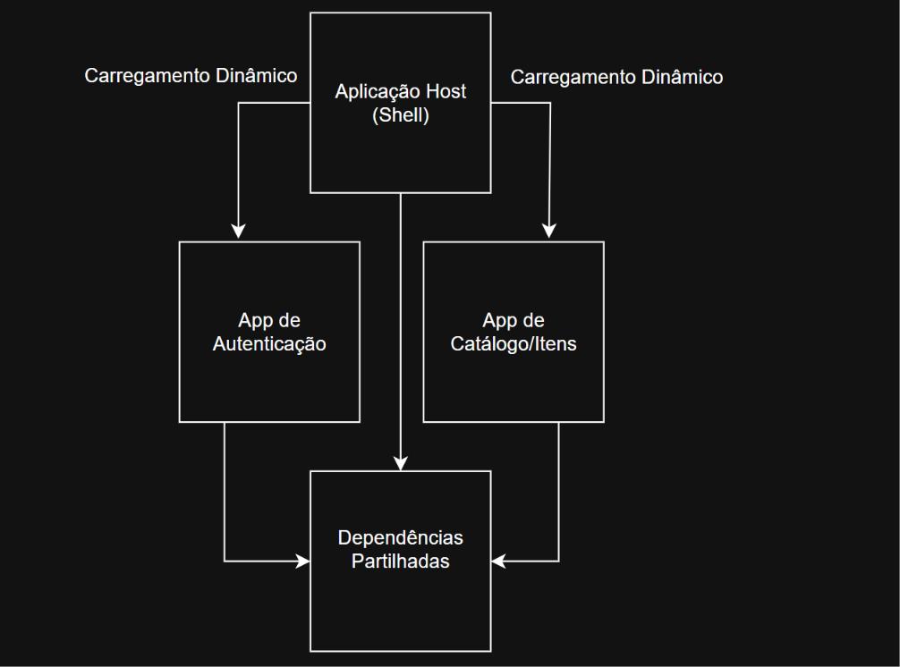

# Seminário — Arquitetura Front-End: Clean Architecture, BFF & Micro-Frontends

**Equipe:** Rubens Corado de Sousa · Filipe Fialho · Miguel Lira

| # | Entrega pedida | Onde está |
|---|---|---|
| 1 | Apresentação teórica com diagramas (monólito × Clean Architecture × Micro-Frontends) | [Diagramas](#1-teoria-e-diagramas) |
| 2 | Projeto estruturado em camadas (Domain, UseCases, Repositories, UI) | [`poc-clean-architecture/`](./poc-clean-architecture) |
| 3 | Prova de conceito de orquestração com BFF | [`poc-bff/`](./poc-bff) |

## Como as 3 partes se ligam



A camada **Repository** da Clean Architecture (parte 2) é exatamente o ponto em que o front se conecta ao **BFF** (parte 3). O mesmo BFF atende dois fronts de frameworks diferentes.

---

## 1. Teoria e diagramas

### Monólito front-end


UI, regra de negócio, chamadas de API e estado global ficam misturados. Resultado: alto acoplamento, código difícil de testar, e qualquer mudança na API quebra a tela.

### Clean Architecture no client


As dependências apontam **para dentro**: UI → Use Cases → Domínio ← Infraestrutura. O domínio não conhece React, HTTP nem BFF. A infraestrutura (Repositories) implementa as interfaces do domínio.

### Micro-Frontends


Um app *host* (shell) carrega em tempo de execução apps independentes (ex.: autenticação e catálogo), cada um de um time e com deploy próprio, compartilhando dependências comuns. No Webpack/Vite isso é feito com **Module Federation**.

**Por que a PoC usa BFF e não Module Federation?** O enunciado permite os dois. O BFF resolve um problema que o próprio projeto da parte 2 já tinha (o Repository precisava de uma API), e fecha a história de ponta a ponta: tela → camadas → BFF → microsserviços.

---

## 2. Demonstração ao vivo

Precisa do **Node 18+** e de internet (o Vue da parte 3 vem do CDN).

```bash
# Terminal 1 — BFF + microsserviços
cd poc-bff
npm start                 # abre em http://localhost:4000 (painel Vue)

# Terminal 2 — projeto em camadas (React)
cd poc-clean-architecture
npm install
npm run dev               # abre em http://localhost:5173 (catálogo React)
```

**Roteiro da demo**

1. **Catálogo React (parte 2):** mostrar as pastas `domain → usecases → repositories → ui`. O preço chega formatado e o produto sem estoque não aparece, porque quem adapta os dados é o BFF.
2. **Painel Vue, modo Sem BFF:** 3 requisições do navegador, e CPF e hash de senha chegando ao navegador.
3. **Modo Com BFF:** 1 requisição e nenhum dado sensível. A linha do tempo mostra as chamadas em **paralelo** e em **sequência**.
4. **Falha ao vivo:** derrubar o serviço de pedidos (rodando cada serviço em um terminal, veja o [README do BFF](./poc-bff)). Com BFF, a tela abre com aviso; sem BFF, a tela quebra.
