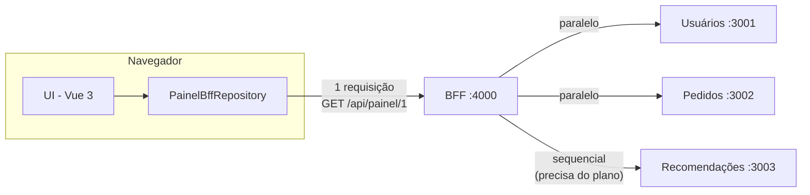

# PoC — Orquestração com BFF (Backend for Frontend)

Parte do seminário **Arquitetura Front-End: Clean Architecture, BFF & Micro-Frontends**.

A tela "Meu Painel" precisa de dados de **3 microsserviços independentes**. Em vez de o navegador chamar os 3, ele chama **um único endpoint do BFF**, que orquestra os serviços e devolve o JSON pronto para a tela.

## Arquitetura



| O BFF faz | Onde está no código |
|---|---|
| **Orquestra**: usuários e pedidos em paralelo; recomendações só depois do usuário (depende do plano) | `bff/server.js` → `montarPainel()` |
| **Agrega**: 3 respostas viram 1 | `bff/server.js` → `return { usuario, pedidos, ... }` |
| **Adapta**: centavos → "R$ 89,90", `EM_TRANSITO` → "Em trânsito" | `bff/server.js` → adaptadores |
| **Protege**: CPF, hash de senha e e-mail não saem do BFF | `bff/server.js` → `usuario: { nome, plano }` |
| **Resiliência**: timeout de 2s e resposta parcial se um serviço cair | `buscar()` + `Promise.allSettled` |

## Como rodar

Precisa só do **Node 18+**. Não há dependências para instalar.

```bash
npm start
```

Abra **http://localhost:4000** (com internet, porque o Vue vem do CDN).

Para a demonstração de falha, rode cada parte em um terminal separado, assim dá para derrubar um serviço com `Ctrl+C`:

```bash
npm run usuarios        # terminal 1
npm run pedidos         # terminal 2
npm run recomendacoes   # terminal 3
npm run bff             # terminal 4
```

## Estrutura

```
servicos/          3 microsserviços independentes (cada um com seus dados e sua porta)
bff/server.js      o BFF: orquestração, agregação, adaptação e resiliência
front/
  index.html       carrega o Vue 3 e monta a aplicação
  src/App.js       camada UI: só desenha, não conhece os serviços
  src/repositories/
    PainelBffRepository.js     COM BFF: 1 chamada
    PainelDiretoRepository.js  SEM BFF: o navegador chama os 3 serviços (só para comparação)
```

O botão **Com BFF / Sem BFF** troca apenas o Repository usado pela UI. A tela é a mesma, o que mostra o desacoplamento da Clean Architecture.

## Ligação com a parte 2 (Clean Architecture em React)

O BFF também tem o endpoint **`GET /api/itens`**, consumido pelo `ApiItemRepository` da [`poc-clean-architecture`](../poc-clean-architecture):

| O serviço devolve | O BFF entrega ao front React (`ItemEntity`) |
|---|---|
| `{ sku, titulo, precoCentavos, estoque, fornecedorId }` | `{ id, nome, preco, descricao? }` |
| todos os produtos | só os que têm estoque |

Ou seja, o **mesmo BFF atende dois fronts diferentes** (o painel em Vue e o catálogo em React). Isso mostra que o BFF não depende do framework da tela.

## Com BFF × Sem BFF

| | Com BFF | Sem BFF |
|---|---|---|
| Requisições do navegador | 1 | 3 |
| Endereços que o front conhece | 1 | 3 |
| Dados sensíveis no navegador | nenhum | cpf, senhaHash, email |
| Formatação (centavos, status) | no BFF | repetida em cada front |
| Um serviço cai | tela carrega com aviso | tela quebra |
